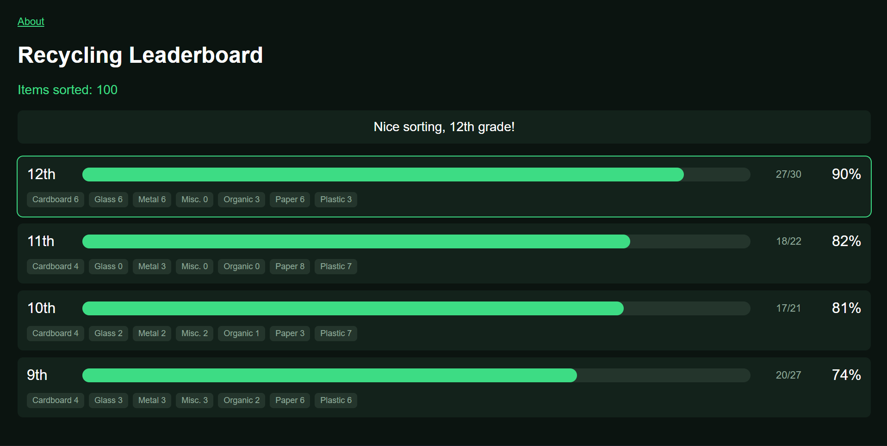
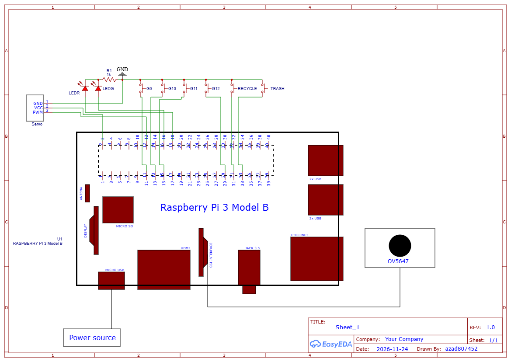

# Competitive Recycling Community

Website: https://crcleaderboard.vercel.app/

This is our project for the CSHS Hackathon 2026.

## What is it

At SAS a lot of people don't recycle, or they put their trash in the wrong bin. Only about 52% of waste in Singapore gets recycled, so we wanted to find a way to get more people to do it.

Our idea was to make recycling a competition between the grades. We made a smart bin that uses AI to tell what kind of trash you put in it, and then your grade gets points on a leaderboard.

## Preview


## How to use it

1. Put something in the bin
2. Predict where the trash will go using the recycle and trash buttons
3. Press your grade button (Don't lie)
4. The bin checks if you put it in the right place
5. The AI figures out what the item is (cardboard, glass, metal, organic, paper, plastic, or misc)
6. Your grade's score goes up or down on the website

Your score is the percent of stuff your grade sorted correctly. So if you put things in the wrong bin your score goes down, which means you can't just throw random stuff in to win.

## Folders

- YOLOTrashRecog - the AI model that recognizes the trash
  - yolo11n-cls from Ultralytics. yolo26n-cls is also on the repo but isn't part of the demo.
- PiCode - the code that runs on the Raspberry Pi in the bin
  - detect.py - Test program for detection through the camera
  - postData.py - Sends information to the Supabase database via an API
  - main.py - Handles main logic and GPIO stuff
- LeaderboardWebsite - the website that shows the scores
  - about.html - HTML for the about page
  - index.html - HTML for the main page
  - script.js - Main script that handles logic
  - supabaseClient.js - Initializer for the supabase client on the webpage to pull data using a SQL query (get_stats())
- Assets - pictures and other files

## Hardware

- Rasberry Pi 3 Model B
- 6 Push buttons (Two could be replaced by a toggleable switch) - 4 for each grade, 2 to predict recycle or not
- 2 LEDs - Green & Red to indicate success on prediction
- OV5647 Camera
- Servo - To pivot the holding platform and dump trash

### Diagram:


## Libraries

### Hardware (Raspberry Pi)

| Library / Tool | Used for |
|---|---|
| [gpiozero](https://gpiozero.readthedocs.io/) | Reading the grade and recycle/trash buttons, driving the LEDs, and controlling the sorting servo |
| [pigpio](https://abyz.me.uk/rpi/pigpio/) | Pin factory (`PiGPIOFactory`) that gives the servo jitter-free PWM. Requires the `pigpiod` daemon to be running |
| [rpicam-apps](https://www.raspberrypi.com/documentation/computers/camera_software.html) (`rpicam-vid`) | Streaming raw YUV420 frames from the OV5647 camera |
| [OpenCV](https://opencv.org/) (`opencv-python`) | Converting camera frames from YUV to BGR |
| [NumPy](https://numpy.org/) | Handling raw frame buffers and averaging predictions over multiple frames |

### Machine Learning

| Library | Used for |
|---|---|
| [Ultralytics YOLO](https://docs.ultralytics.com/) | Training (`train.py`), testing (`test.py`) and running the image classifier. The model is exported to NCNN for fast inference on the Pi |
| [PyTorch](https://pytorch.org/) | Backend for Ultralytics training (installed with it) |
| [split-folders](https://pypi.org/project/split-folders/) | Splitting the dataset 80/20 into train and validation sets (`data.py`) |

**Datasets:** [RealWaste](https://archive.ics.uci.edu/dataset/908/realwaste) for training and [TrashNet](https://github.com/garythung/trashnet) for testing.

### Backend

| Library / Service | Used for |
|---|---|
| [Supabase](https://supabase.com/) | Hosted Postgres database, the `get_stats` RPC and Realtime updates |
| [supabase-py](https://github.com/supabase/supabase-py) | Posting each sorted item from the Pi (`postData.py`) |

### Website

| Library | Used for |
|---|---|
| [supabase-js](https://github.com/supabase/supabase-js) (v2, loaded via jsDelivr CDN) | Fetching stats and subscribing to live `INSERT` events so the leaderboard updates instantly |

### Standard Library

`subprocess`, `threading`, `time`, `signal`, `random`, `shutil`, `pathlib`, `collections`, `os`

### Installation

```bash
# On the Raspberry Pi
pip install gpiozero pigpio numpy opencv-python ultralytics supabase
sudo apt install rpicam-apps pigpio
sudo pigpiod -p 8889 #On boot after activating venv

# For training and data prep (on your PC)
pip install ultralytics split-folders
```


## Why we made this

We think people will care more about recycling if there's a competition. Hopefully this gets more people at our school to recycle the right way. Even if the image recognition isn't ideal we hope that this spreads awareness.

## Credits
Single, S., Iranmanesh, S., & Raad, R. (2023). RealWaste [Dataset]. UCI Machine Learning Repository. https://doi.org/10.24432/C5SS4G.
